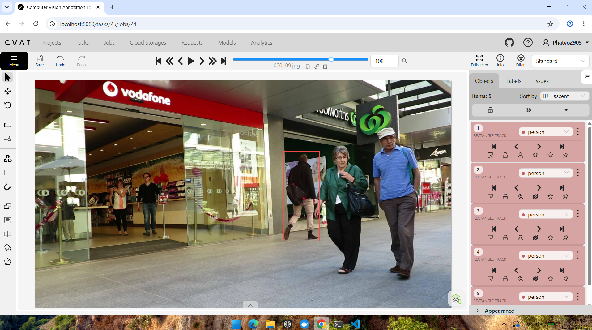
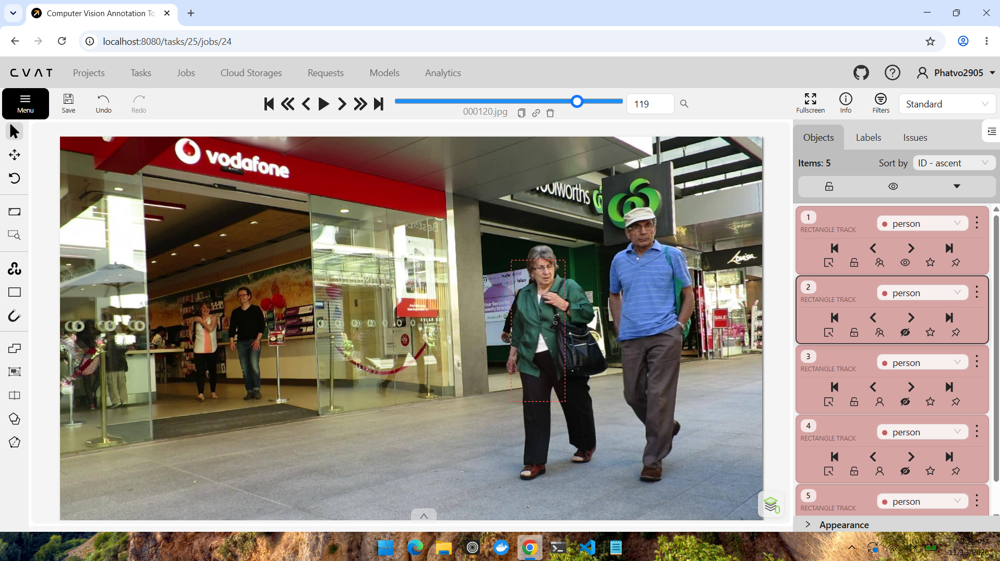
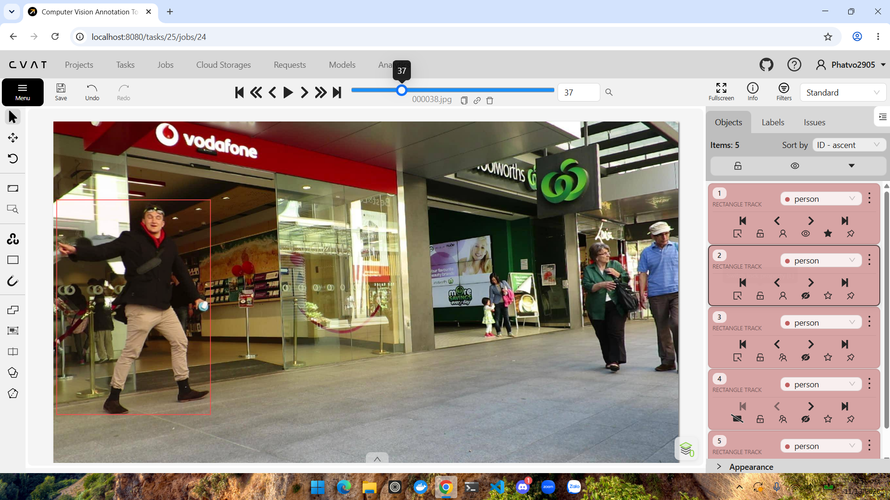

# Báo cáo cá nhân — HoVaTen-MSSV

Đổi tên file theo quy tắc `MSSV_HoTen.md`. Ví dụ: `20241234_NguyenVanAn.md`.

Đoạn video: MOT17-09, 150 frame (frame 1–150), nguồn MOTChallenge, giấy phép CC BY-NC-SA 3.0.

## 0. Thông tin học viên

- Họ tên: Võ Nguyễn Thành Phát
- MSSV: 202603195
- Mã đề (A/B/C): C
- Email: vonguyenthanhphat2905@gmail.com
- Link repository: https://github.com/BinBin2905/K5-L2A-Day05-VoNguyenThanhPhat-2A202603195-MOTTracking
- Giờ bắt đầu: 16h
- Giờ kết thúc: 18h

## 1. Xem trước đoạn video (CP0)

Ghi **trước khi vẽ**, mỗi người một dòng.

| Mã  | Frame xuất hiện | Frame cuối thấy được | Rẽ / dừng / đổi tốc độ ở frame | Bị che ở frame | Ghi chú |
| --- | --------------- | -------------------- | ------------------------------ | -------------- | ------- |
| P1  | 0               | 108                  | thay đổi tốc độ frame 50       | 0-36,108-149   |         |
| P2  | 0               | 89                   | không thay đổi                 | 90-149         |         |
| P3  | 0               | 149                  | không thay đổi                 | 0-70           |         |
| P4  | 70              | 149                  | không thay đổi                 | 70-109         |         |
| P5  | 0               | 149                  | không thay đổi                 | 0-55,100-112   |         |

## 2. Keyframe và thời gian (CP1, CP4)

Số keyframe lấy từ kết quả `src/check_submission.py`.

| Mã       | Số keyframe | Keyframe ở frame                                                                                                    | Số frame có mặt | Keyframe / 100 frame | Thời gian (phút) | Chỗ khó |
| -------- | ----------- | ------------------------------------------------------------------------------------------------------------------- | --------------- | -------------------- | ---------------- | ------- |
| P1       | 27          | [0, 10, 20, 30, 34, 37, 40, 45, 50, 55, 60, 62, 67, 70, 78, 80, 84, 90, 93, 100, 102, 109, 110, 124, 127, 130, 149] | 150             | 18.0                 | 5                |         |
| P2       | 7           | [0, 10, 20, 80, 90, 100, 136]                                                                                       | 150             | 4.7                  | 5                |         |
| P3       | 15          | [0, 10, 20, 30, 40, 50, 60, 70, 80, 90, 100, 120, 130, 140, 149]                                                    | 150             | 10.0                 | 5                |         |
| P4       | 9           | [70, 80, 90, 100, 110, 120, 130, 140, 149]                                                                          | 80              | 11.2                 | 5                |         |
| P5       | 10          | [0, 20, 56, 60, 70, 90, 100, 112, 120, 149]                                                                         | 150             | 6.7                  | 5                |         |
| **Tổng** |             |                                                                                                                     |                 |                      |                  |         |

Keyframe / 100 frame của cả bài = tổng keyframe ÷ tổng số frame có mặt × 100 =( 68/680 x 100 )= 10.0 KF/100F

Bạn đặt keyframe nhiều nhất ở người nào? Vì sao (người đó rẽ, dừng, lại gần camera hay bị che)?

Đặt keyframe nhiều nhất ở P1 vì P1 có thay đổi tốc độ lẫn góc nhìn dẫn đến thu nhỏ box

## 3. Đoạn bị che (CP2)

Người bị che: `P1`

| Mốc                                      |           Frame |
| ---------------------------------------- | --------------: |
| Bắt đầu bị che một phần (bật `occluded`) |               0 |
| Mất hẳn (bật `outside`)                  | chỉ bị occluded |
| Hiện lại (tắt `outside`)                 | chỉ bị occluded |
| Thấy rõ trở lại (tắt `occluded`)         |          37-108 |

- Thời gian khuất hẳn: **0 frame = 0** giây. P1 chỉ occluded
- Quyết định: giữ cùng ID
- Lý do (trả lời 3 câu: khuất bao lâu so với 60 frame, ngoại hình có khớp, chỗ hiện lại có đúng hướng và tốc độ):
  khuất bao lâu so với 60 frame: chỉ bị occluded, 0-36 frame đầu, 109-149 frame sau
  ngoại hình có khớp: Vẫn khớp
  chỗ hiện lại có đúng hướng và tốc độ: Vẫn cùng hướng và tốc độ

Ảnh chụp màn hình:

 - P1 bị che từ frame 0 nên em xin phép lấy ảnh từ frame sau ( frame 37-108)
 - P1 này bị che ở frame đầu và frame sau nên em xin phép lấy frame sau để trình bày ( frame 109-149)
 - em xin phép lấy ảnh lúc hiện lại sau khi bị che ở các frame đầu ( frame hiện lại frame 37-108 )

## 4. Tự review ID (CP3)

Lượt 1 theo người (đi ngược từ frame 149 về 0 trên CVAT), lượt 2 theo cảnh (nhảy 10 frame). Ít nhất 3 dòng; không có lỗi thì ghi một dòng "đã kiểm hai lượt, không lỗi".

Loại lỗi dùng đúng một trong 7 mã: `id_switch`, `fragmentation`, `lost`, `merge`, `false_track`, `drift`, `flag`.

| Frame | Mã người | Loại lỗi | Mô tả một câu | Phát hiện ở lượt | Đã sửa? |
| ----: | -------- | -------- | ------------- | ---------------- | ------- |
|       |          |          |               |                  |         |
|       |          |          |               |                  |         |
|       |          |          |               |                  |         |

Tổng hợp số lỗi theo loại:

| `id_switch` | `fragmentation` | `lost` | `merge` | `false_track` | `drift` | `flag` |
| ----------: | --------------: | -----: | ------: | ------------: | ------: | -----: |
|             |                 |        |         |               |         |        |

Lỗi nào chỉ lượt 2 (theo cảnh) mới thấy, lượt 1 (theo người) không thấy? Vì sao?

- đã kiểm hai lượt, không lỗi

## 5. File xuất và kết quả tự kiểm (CP4)

| Kiểm tra                                                  | Kết quả                          |
| --------------------------------------------------------- | -------------------------------- |
| Tên file MOT 1.1                                          | VoNguyenThanhPhat_mot.zip        |
| Tên file CVAT for video 1.1                               | VoNguyenThanhPhat_cvat_video.zip |
| Số track ID khác nhau trong `gt/gt.txt` (phải là 5)       | đúng                             |
| Frame `outside` không có dòng trong `gt.txt` (đúng / sai) | đúng                             |
| Job đã completed trên CVAT máy cá nhân                    | completed                        |

Dán phần tóm tắt in ra từ `src/check_submission.py`:

```
=== Tóm tắt ===
  Lỗi: 0   |   Cảnh báo: 0
  Đạt. Dán phần tóm tắt này vào báo cáo mục 5.
...
```

## 6. Ba câu kết

1. Nếu được gán lại, bạn sẽ đặt keyframe khác ở đâu? Vì sao?

   Chỗ đổi hướng, đổi tốc độ, đổi kích thước rõ.
   Gán vào những frame trên để có thể giảm thiểu số keyframe nhiều quá thì tốn công và box rung

2. Có chỗ nào bạn không chắc "cùng ID hay ID mới"? Bạn đã quyết định và ghi chú thế nào?

   ...

3. Một lỗi ID trong job của bạn (nếu không còn sót, chọn lỗi đã sửa) có thể làm xe tự lái dự đoán sai chuyển động của người đó như thế nào? Lỗi đó ảnh hưởng MOTA hay IDF1 nhiều hơn?

   -Hiện tại job em làm chưa có lỗi liên quan đến ID nhưng giả sử lỗi nhầm ID1 và ID2 thì sẽ Xe tự lái dự đoán sai thế nào

   -ID 2 thừa hưởng lịch sử của ID 1. Người ở xa, đang đứng yên, bị dự đoán là đang lao ngang. Xe có thể phanh hoặc né không cần thiết, gây nguy hiểm cho xe sau. ID 1 thừa hưởng lịch sử của ID 2. Người ở gần, đang bước sang phải, bị dự đoán là đứng yên. Bộ dự đoán quỹ đạo sẽ cho rằng người này không cắt vào làn xe, nên xe giảm tốc muộn hoặc không nhường.

   -IDF1 bị ảnh hưởng nhiều hơn. MOTA = 1 − (FN + FP + IDSW)/GT chỉ tính mỗi lần đổi ID một lần. IDF1 phạt mọi frame mà ID còn sai.

## Bonus (nếu làm)

### B1 — Hai người đi sát

...

### B2 — So cách đặt keyframe

| Cách đặt           | Số keyframe | Frame trôi nhất | Ghi chú |
| ------------------ | ----------: | --------------: | ------- |
| Đều mỗi 30 frame   |             |                 |         |
| Theo chỗ đổi hướng |             |                 |         |

...

### B3 — So với tracker có sẵn

| Frame | Mã người | Tracker làm gì | Nhãn của bạn | Giải thích (đoán rồi sửa / ghép IoU / box score thấp / ngoại hình) |
| ----: | -------- | -------------- | ------------ | ------------------------------------------------------------------ |
|       |          |                |              |                                                                    |
|       |          |                |              |                                                                    |

## 7. Tài liệu tham khảo và công cụ AI đã dùng

Không sử công cụ nào
